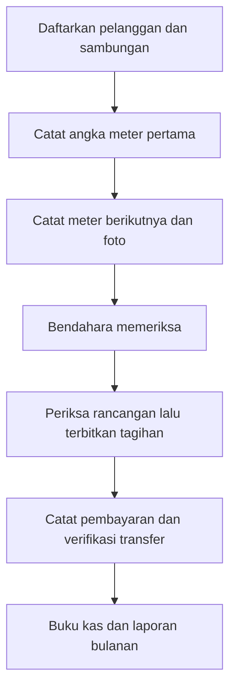

# Airbersih KSM

Aplikasi administrasi air **KSM Banyu Bening RT05** untuk mencatat pelanggan, angka meter, tagihan, pembayaran, kas, dan laporan bulanan.

**[Buka aplikasi](https://airbersih-ksm.vercel.app/login)** · **[Panduan publik](https://morrispes5.github.io/Airbersih-KSM/)** · **[Mulai untuk agent AI](AI_START_HERE.md)** · **[Status cloud](docs/CLOUD_STATUS.md)**

## Cara kerjanya

Contoh: meter 100 menjadi 130 → pemakaian 30 m³ → Rp300.000 + administrasi Rp5.000 = **Rp305.000**. Ini contoh hitungan, bukan transaksi nyata.

## Siapa yang memakai?

| Peran | Pekerjaan |
| --- | --- |
| Pengurus utama | Akun, tarif, persetujuan, saldo awal, dan salinan cadangan |
| Bendahara | Pemeriksaan meter, tagihan, pembayaran, kas, dan laporan |
| Petugas meter | Angka dan foto untuk rumah yang ditugaskan |

## Isi repository

- `web/`: aplikasi PHP/Laravel 13 dan Livewire 4, PostgreSQL, private file storage, database queue.
- `site/`: panduan publik HTML yang bisa dibaca tanpa login; tidak tersambung ke data warga.
- `docs/`: panduan pengurus, arsitektur, status cloud, dan persiapan server tanpa Docker.
- `AI_START_HERE.md` dan `AGENTS.md`: konteks dan aturan untuk agent pengembang.
- `scripts/`: alat pemeriksaan dan publikasi; skrip operasional memerlukan konfigurasi privat yang tidak disertakan.

## Status yang perlu dipahami

**Aplikasi Laravel sudah berjalan sementara di Vercel** pada alamat di atas, memakai database Aiven dan storage privat Supabase yang sudah ada. GitHub Pages menayangkan penjelasan tanpa login. Login akun, 11 halaman pengurus, Livewire update, serta upload cloud sintetis dan cleanup diverifikasi. WoWSQL terhubung ke plugin tetapi koneksi PostgreSQL langsungnya gagal pencocokan sertifikat TLS, sehingga belum menjadi database aplikasi. Lihat [status cloud](docs/CLOUD_STATUS.md).

Catatan proyek 17 Oktober 2026 memisahkan riwayat 51 anggota Desember 2025 dari pelanggan/sambungan operasional. Data awal dan penerimaan pengurus belum boleh dianggap selesai hanya karena kode atau tes tersedia.

## Menjalankan dan memeriksa

Lihat [panduan server tanpa Docker](docs/DEPLOYMENT.md). Gunakan PHP 8.4, Composer 2, Node 22 untuk build aset, PostgreSQL dengan TLS terverifikasi, dan penyimpanan privat. Konfigurasi contoh belum cukup untuk menjalankan transaksi: target database harus lolos guard dan disediakan secara terpisah.

CI memeriksa kualitas kode/build tanpa kredensial cloud. Tes database/browser membutuhkan lingkungan uji terisolasi; jangan jalankan fresh atau seed terhadap operasional.

## Privasi dan keamanan

Repository ini tidak menyertakan akun, password, `.env`, token, sertifikat, Excel asli, data warga, foto meter, bukti pembayaran, dump database, recovery key, atau riwayat Git lokal. Materi publik berisi penjelasan dan contoh sintetis. Jangan mengirim data warga ke issue publik.
