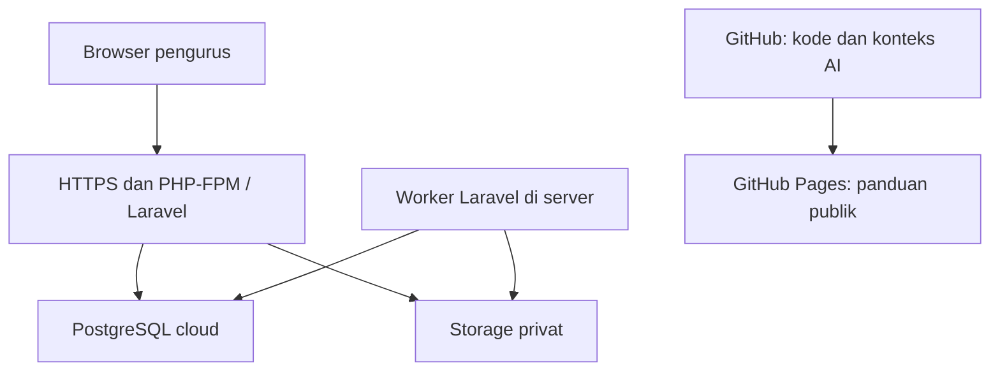

# Arsitektur Airbersih KSM

## Permintaan pengguna

Browser → Laravel/Livewire → PostgreSQL dan penyimpanan berkas privat. Antarmuka memakai Blade, Tailwind dan aset yang dibangun Vite. Node tidak diperlukan terus-menerus saat aplikasi berjalan.

## Hubungan data

Pelanggan memiliki sambungan rumah; sambungan memiliki meter dan petugas. Bacaan meter yang diperiksa menjadi dasar tagihan. Tagihan menyimpan snapshot pelanggan, tarif, pemakaian dan total. Pembayaran terkonfirmasi mencatat penerimaan; pengeluaran dan pemindahan kas dikelola terpisah. Audit dan reversal mempertahankan histori.

Sumber Excel masuk register/preview/riwayat. Isi sumber yang belum diverifikasi tidak otomatis menjadi pelanggan, invoice atau saldo. Riwayat anggota lama tidak mengaktifkan sambungan saat ini.

## Akses

Session login, CSRF, pembatasan login, gate peran dan pemeriksaan penugasan berada di aplikasi. Pengunduhan foto/PDF memerlukan otorisasi. Tidak ada portal warga atau payment gateway otomatis.

## Kebutuhan deployment

PHP 8.4 + ekstensi pada lockfile, web server dengan document root `web/public`, worker antrean, PostgreSQL terisolasi dengan TLS verify-full, private object storage, dan lokasi rahasia di luar document root. Saat ini guard terikat ke identitas Aiven; jangan berasumsi mengganti DB_HOST saja cukup untuk WoWSQL.

Server menjalankan PHP dan worker secara langsung tanpa Docker. Situs GitHub Pages bersifat statis dan tidak memproses transaksi.
